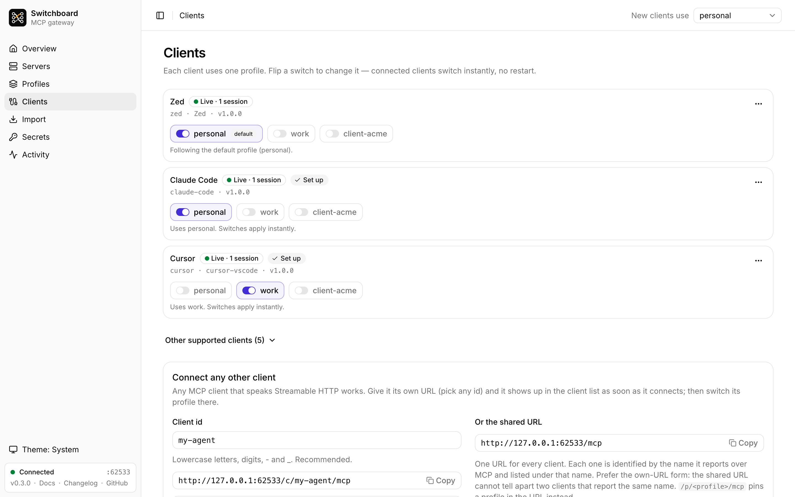
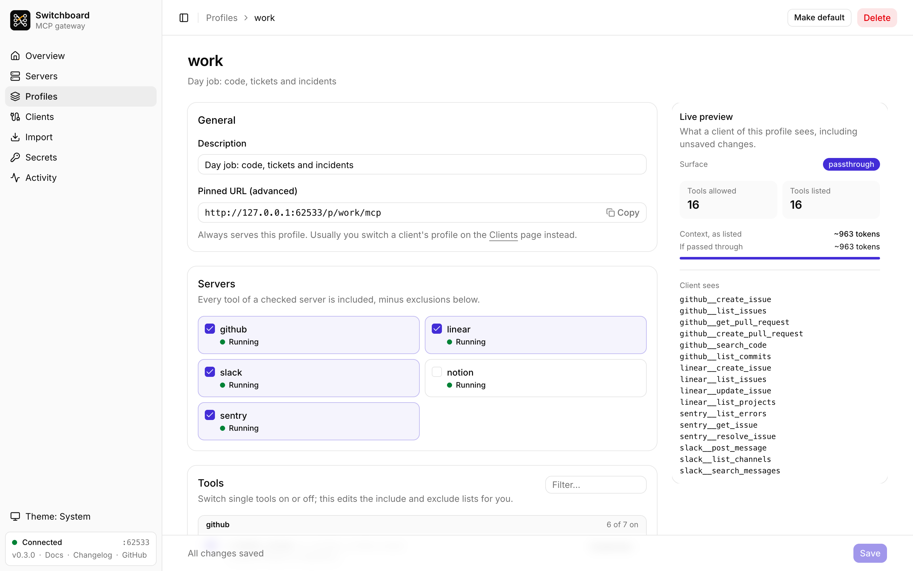
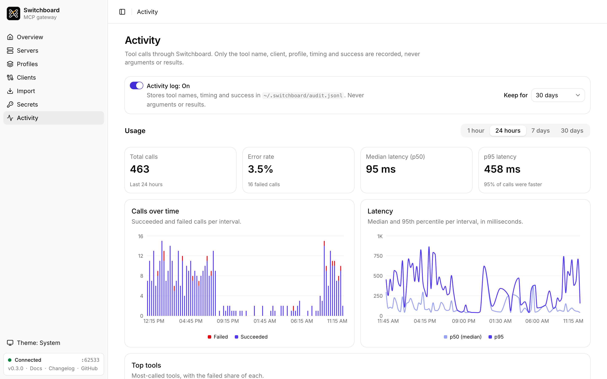
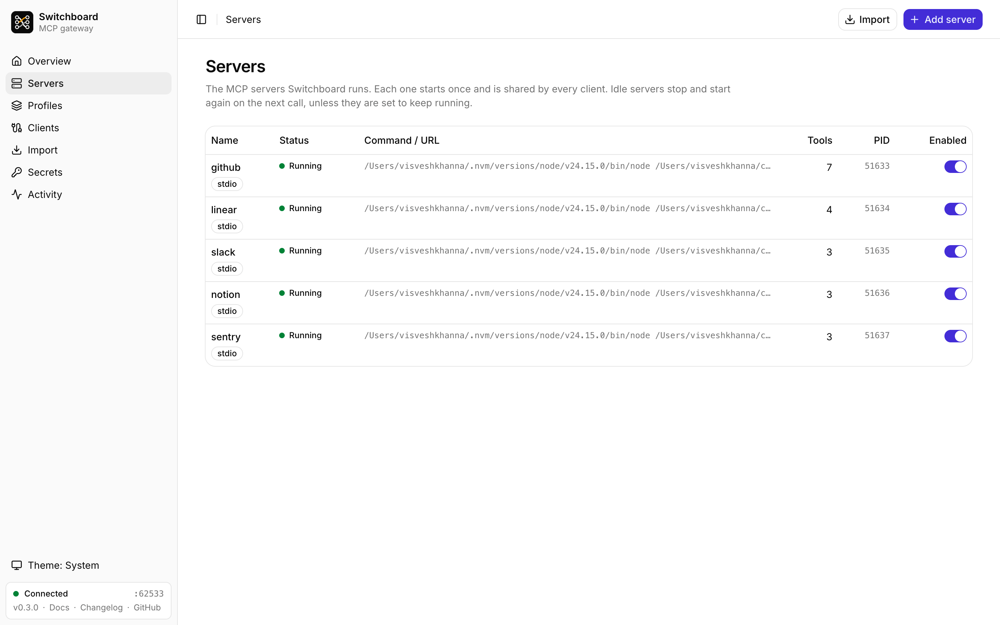
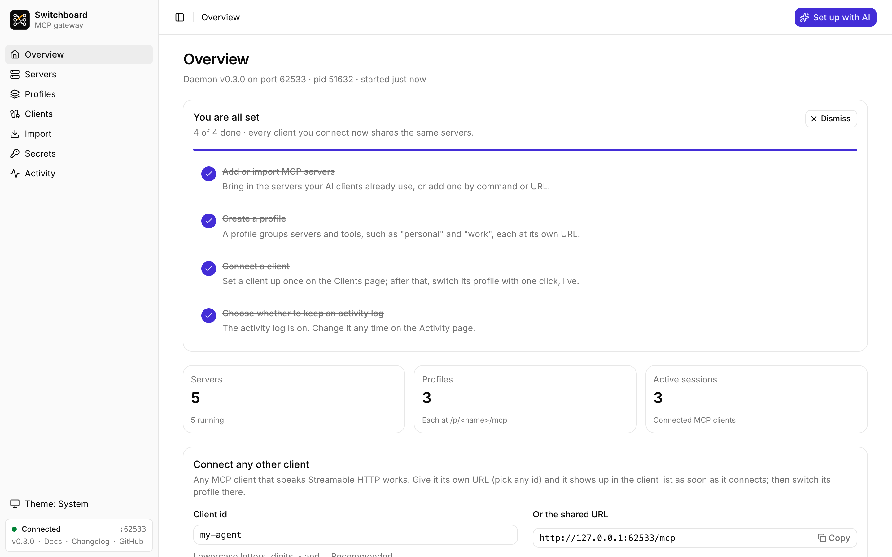

<div align="center">


# Switchboard

**One MCP endpoint for all your AI agents.**

Group your MCP servers into profiles (personal, work, a client's) and give Cursor, Claude Code, VS Code and every other agent exactly the tools it should see. Switch a client's profile with one click; it changes live, without restarting anything.

[](https://www.npmjs.com/package/mcp-switchboard)
[](https://github.com/visveshkhanna/Switchboard/actions/workflows/ci.yml)
[](https://github.com/visveshkhanna/Switchboard/blob/main/LICENSE)
[](https://switchboard.visvesh.dev/docs)

[Docs](https://switchboard.visvesh.dev/docs) · [Quick start](#quick-start) · [Self-hosting](#run-it-on-a-server) · [Changelog](https://github.com/visveshkhanna/Switchboard/blob/main/CHANGELOG.md)

</div>

<picture>
  <source media="(prefers-color-scheme: dark)" srcset="https://raw.githubusercontent.com/visveshkhanna/Switchboard/main/.github/assets/clients-dark.png">
  
</picture>

## Why

- **Profiles, not toggles.** Stop enabling and disabling servers in every project. Define `personal`, `work` and `client-acme` once.
- **Switch live.** Set a client up once; after that its profile is a switch in Switchboard. Flip it and the client gets the new tools instantly, with no config edit or restart.
- **Any client.** Cursor, Claude Code, Claude Desktop, VS Code, Windsurf, Codex and Gemini CLI are set up for you; any other MCP client shows up the moment it connects.
- **One process per server.** Ten clients share one copy of each MCP server, started when added, stopped when idle and restarted if it crashes.
- **Less context.** Large profiles can be served as `search_tools` / `get_schema` / `call_tool`, or as one `execute` tool where the model writes code that calls tools in a sandbox.
- **Local first, hostable.** Runs on your machine with secrets in your OS keychain, or on a server with API keys and a login, from one Docker image.

## Quick start

```bash
npx mcp-switchboard up
```

This starts Switchboard and opens it at <http://localhost:7690> (Node 24 or later). Then:

1. **Import** the MCP servers you already use in Cursor, Claude Code, Claude Desktop or VS Code, or add new ones.
2. **Create profiles** and pick the servers and tools in each. The first one becomes the default.
3. **Set up your clients** on the Clients page (one click each, restart the client once), then switch their profiles whenever you like.

Prefer to let your agent do it? The **Set up with AI** button gives you a prompt to paste into Claude Code, Cursor or Codex.

<table>
  <tr>
    <td width="50%">
      <picture>
        <source media="(prefers-color-scheme: dark)" srcset="https://raw.githubusercontent.com/visveshkhanna/Switchboard/main/.github/assets/profile-dark.png">
        
      </picture>
      <p align="center"><sub><b>Profiles</b> with a live preview of what a client sees and what it costs in context</sub></p>
    </td>
    <td width="50%">
      <picture>
        <source media="(prefers-color-scheme: dark)" srcset="https://raw.githubusercontent.com/visveshkhanna/Switchboard/main/.github/assets/activity-dark.png">
        
      </picture>
      <p align="center"><sub><b>Activity</b>: calls, errors and latency, from an opt-in log that never stores arguments</sub></p>
    </td>
  </tr>
  <tr>
    <td width="50%">
      <picture>
        <source media="(prefers-color-scheme: dark)" srcset="https://raw.githubusercontent.com/visveshkhanna/Switchboard/main/.github/assets/servers-dark.png">
        
      </picture>
      <p align="center"><sub><b>Servers</b> with live status, logs, OAuth sign-in and automatic restarts</sub></p>
    </td>
    <td width="50%">
      <picture>
        <source media="(prefers-color-scheme: dark)" srcset="https://raw.githubusercontent.com/visveshkhanna/Switchboard/main/.github/assets/overview-dark.png">
        
      </picture>
      <p align="center"><sub><b>Overview</b> with a getting-started checklist and copy-paste snippets</sub></p>
    </td>
  </tr>
</table>

## How clients get their tools

Each client is set up once with its own URL, which Switchboard writes into the client's config file for you:

```jsonc
// ~/.cursor/mcp.json
{
  "mcpServers": {
    "switchboard": { "url": "http://127.0.0.1:7690/c/cursor/mcp" }
  }
}
```

From then on, which profile Cursor gets is a setting in Switchboard. New clients use the default profile, and any MCP client can connect to `/c/<any-name>/mcp` or the shared `/mcp` and appear in the list. To pin a connection to one profile instead, use `/p/<profile>/mcp`. Clients that only speak stdio use `switchboard connect --client <name>`.

## Tool surfaces

Each profile chooses how its tools are presented:

| Surface | What the client sees | Best for |
|---|---|---|
| `passthrough` | every allowed tool, as is | small profiles |
| `meta` | `search_tools`, `get_schema`, `call_tool` | many tools, any model |
| `code` | `execute`: the model writes JavaScript that calls tools in a sandbox | multi-step work across tools |
| `auto` | `passthrough` for small profiles, `meta` above a threshold | the default |

## From the terminal

Everything in the web UI is also a command:

```bash
switchboard import                                   # servers from your AI clients
switchboard server add github -- npx -y @modelcontextprotocol/server-github
switchboard server add linear --url https://mcp.linear.app/mcp
switchboard server auth linear                       # OAuth sign-in in the browser
switchboard secret set github-token                  # use as secret://github-token
switchboard profile add work --servers github,linear
switchboard client connect cursor                    # set it up once
switchboard client use cursor work                   # switch its profile, live
switchboard status
```

`~/.switchboard/config.json` is plain JSON you can also edit by hand; Switchboard reloads it and tells connected clients when their tools change.

## Run it on a server

One setup for every machine you work on, and for cloud agents that need an HTTPS MCP URL:

```bash
docker run -d -p 7690:7690 -v switchboard:/data \
  -e SWITCHBOARD_ADMIN_PASSWORD='a long password' \
  -e SWITCHBOARD_PUBLIC_URL=https://switchboard.example.com \
  ghcr.io/visveshkhanna/switchboard:latest
```

Hosted, every MCP client needs an API key (each key acts as one client, so its profile switches like any other) and the web UI asks for the admin password. [`deploy/`](https://github.com/visveshkhanna/Switchboard/tree/main/deploy) has Docker Compose with automatic HTTPS and a Fly.io config; see the [Self-hosting guide](https://switchboard.visvesh.dev/docs/guides/self-hosting).

## Develop

```bash
pnpm install
pnpm dev        # daemon from source + web UI with hot reload, isolated from your real setup
pnpm check      # lint, type-check and test
```

See [CONTRIBUTING.md](https://github.com/visveshkhanna/Switchboard/blob/main/CONTRIBUTING.md). Report security problems as described in [SECURITY.md](https://github.com/visveshkhanna/Switchboard/blob/main/SECURITY.md).

## License

[Apache License 2.0](https://github.com/visveshkhanna/Switchboard/blob/main/LICENSE). See [NOTICE](https://github.com/visveshkhanna/Switchboard/blob/main/NOTICE) for credits.
